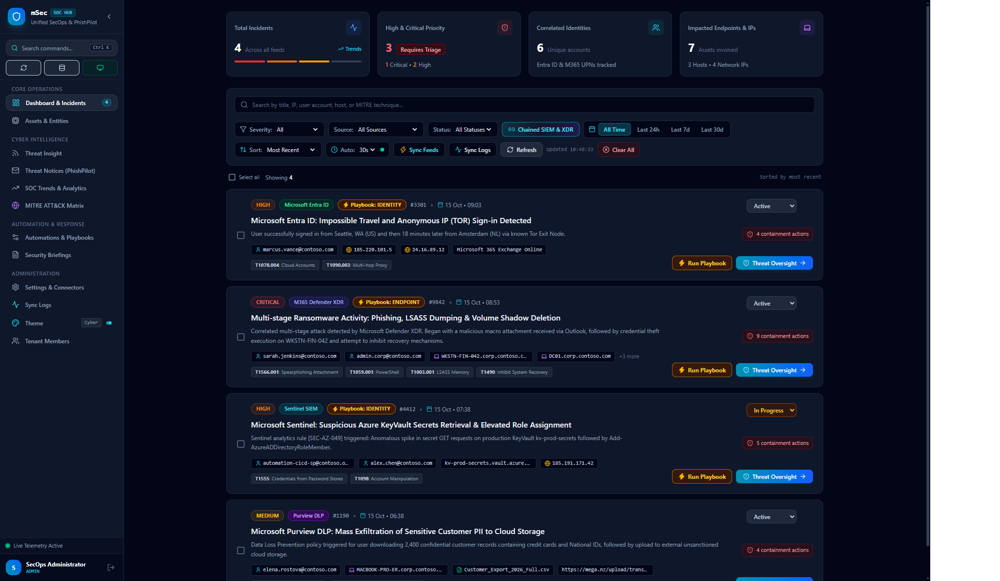

# mSec — Tier-3 SecOps Command Hub & Threat Ingestion Platform

<p align="center">
  
  
  
  
  
  
</p>

<p align="center">
  <strong>A unified, enterprise-grade Security Operations Platform for Microsoft 365 Defender (XDR), Microsoft Sentinel (SIEM), and Microsoft Entra ID.</strong><br>
  Engineered for Tier-1 to Tier-3 incident responders, SOC leads, and threat hunters. Features automated ingestion normalization, cross-incident entity correlation, automated SOAR containment playbooks, PhishPilot email & Quishing QR forensics, a fullscreen tactical War Room HUD, 15 curated color themes, and native zero-dependency SQLite persistence.
</p>

<p align="center">
  
</p>

---

## ⚡ Instant Quickstart (Zero-Cloud Sandbox)

mSec runs **100% self-contained and sandboxed** right out of the box. **No cloud credentials or Microsoft Azure tenants are required** to test and explore every capability.

```bash
# 1. Clone the repository
git clone https://github.com/MaxVonk/mSec.git
cd mSec

# 2. Install dependencies
npm install

# 3. Launch sandboxed environment (Vite frontend + Node.js API concurrently)
npm run demo
```

- **Web Dashboard:** [http://localhost:5173](http://localhost:5173) (development port with hot reload, proxied to API at port 3310)
- **Production / Docker Port:** [http://localhost:3310](http://localhost:3310)
- **Default Local Administrator Credentials:**
  - **Username:** `admin`
  - **Password:** `AdminSecure2026!`

Alternatively, launch using Docker:
```bash
docker compose up -d
```

---

## 🎮 2-Minute Interactive Sandbox Tour

Once the application is open, try these built-in sandboxed workflows:

1. **PhishPilot & Quishing QR Forensics**:
   - Open **PhishPilot** from the navigation bar.
   - Click **"Phishing & Quishing EML"** at the bottom of the submission card (or drag & drop `samples/sample_phishing.eml`).
   - Inspect the automatically decoded QR payload URL, optical matrix analysis, SPF/DMARC hard failures, and test tenant-wide mailbox purge simulation.
2. **SOAR Rapid-Containment Playbook**:
   - Navigate to **Playbooks** in the sidebar.
   - Select an incident and launch *Ransomware Host & Process Isolation* or *Compromised Identity Rapid Containment*.
   - Keep **Simulation Mode** enabled to step through live API dispatch and synthesized terminal audit logs without touching production.
3. **Switch Color Themes (<kbd>Alt</kbd> + <kbd>T</kbd>)**:
   - Press <kbd>Alt</kbd> + <kbd>T</kbd> or click **Theme** in the sidebar to open the color theme library.
   - Use <kbd>↑</kbd> and <kbd>↓</kbd> to live-preview across 15 curated dark, tactical, and clean daylight themes.
4. **Security Briefings**:
   - Open **Security Briefings** from the sidebar to compile on-demand KPI telemetry, active containment statuses, and export one-click Markdown briefings.

---

## 🛡️ Key Capabilities

### 1. Multi-Source Ingestion & Automated Normalization
- Consolidates Microsoft 365 Defender XDR, Sentinel SIEM incidents, and Entra ID risky sign-ins into a unified schema (`UnifiedIncident`).
- Automatically chains and deduplicates alerts from multiple providers targeting the same entity within sliding temporal correlation windows.
- Extracts entities (UPNs, hostnames, external IPs, process command lines, file hashes) into an interactive graph explorer.

### 2. PhishPilot: Email Threat Analysis & Quishing Forensics
- **RFC 822 Email Parser**: Deep header forensics, SPF/DKIM/DMARC alignment validation, Reply-To mismatch detection, and homoglyph spoof detection.
- **Embedded Quishing Engine**: Decodes QR barcodes from raw image attachments and base64 inline HTML email bodies, extracting destination URLs and evaluating credential harvesting risks.
- **Automated Threat Intelligence**: STIX 2.1 JSON bundle export, automated user coaching feedback generation, and automated tenant mailbox purge simulation.

### 3. SOAR Automated Playbook Runner
- Prebuilt, sequential rapid-containment playbooks:
  - *Compromised Identity Rapid Containment* (Revoke active sessions, enforce password reset, elevate MFA)
  - *Ransomware Host & Process Isolation* (Isolate endpoint, terminate malicious PIDs)
  - *Phishing Campaign Tenant Purge* (Purge mailboxes, add TABL drop rules, notify recipients)
  - *Data Exfiltration Perimeter Blockade* (Block C2 egress IPs, quarantine illicit consent OAuth apps)
- Interactive target scoping with dry-run **Simulation Mode** toggle and real-time execution audit logs.

### 4. Tactical SOC War Room & MITRE ATT&CK Mapping
- **Fullscreen HUD**: High-contrast tactical monitoring layout designed for SOC display walls.
- **Synthesized Web Audio Alerts**: Zero-dependency procedural audio cues for high-severity alerts and playbook completions.
- **MITRE ATT&CK Matrix**: 12-tactic visual attack lifecycle heatmap with direct 1-click playbook invocation from mapped techniques.

### 5. 15 Curated Color Themes (Dark, Tactical & Light)
- **Tactical**: Cyber Cyan (Default), Crimson Defense HUD, Matrix Phosphor Terminal.
- **Developer Classics**: Dracula Pro, Tokyo Night Storm, Catppuccin Mocha, Nordic Frost, Monokai Pro, Synthwave '84, GitHub Dark Dimmed.
- **Clean Daylight Themes**: GitHub Light, Catppuccin Latte, Nord Snow Storm, Solarized Light, Quiet Light.
- **Keyboard Driven**: Press <kbd>Alt</kbd> + <kbd>T</kbd> for instant live preview, search filtering, and zero-flicker persistence.

### 6. Native SQLite Persistence & Bidirectional Cloud Sync
- **Native SQLite WAL Engine**: Zero external database dependencies (`node:sqlite`). All incidents, connector configs, and feeds persist in `.msec_data/msec.db`.
- **Two-Way Cloud Sync**: Push status changes, classifications (*TruePositive*, *FalsePositive*, *BenignPositive*), and investigation comments back to Microsoft Graph Security and Azure Sentinel ARM APIs.

---

## 🚀 Production Deployment (Docker Compose & HTTPS)

Deploy mSec in production with automated SSL/TLS certificate management:

```bash
# 1. Clone the repository
git clone https://github.com/MaxVonk/mSec.git
cd mSec

# 2. Configure environment
cp .env.example .env
# Edit .env with your domain and notification settings

# 3. Launch the container stack
docker compose up -d
```

### Automated Let's Encrypt SSL/TLS (Certbot)

mSec supports both internet-facing servers (HTTP-01) and private/internal corporate networks (DNS-01):

#### Option A: DNS-01 Challenge (Recommended for Internal Networks)
Operates behind private networks without opening port 80 to the public internet:
1. Set the following in `.env`:
   ```env
   CERTBOT_CHALLENGE_METHOD=dns
   CERTBOT_DNS_PROVIDER=cloudflare
   CERTBOT_IMAGE=certbot/dns-cloudflare:latest
   CERTBOT_DNS_CREDENTIALS_FILE=./certbot/creds/cloudflare.ini
   ```
2. Create `./certbot/creds/cloudflare.ini` with your Cloudflare API token (`chmod 600`).
3. Run `./init-letsencrypt.sh` to initialize certificates.

#### Option B: HTTP-01 Challenge (Internet-Facing Servers)
Requires public port 80 open:
```env
CERTBOT_CHALLENGE_METHOD=http
```
Run `./init-letsencrypt.sh` once, then start with `docker compose up -d`. Certbot automatically checks and renews certificates every 12 hours.

---

## ⚙️ Configuration Reference

All settings can be configured via environment variables or a root `.env` file:

| Variable | Default | Purpose |
| :--- | :--- | :--- |
| `PORT` | `3310` | HTTP backend listening port |
| `NODE_ENV` | `development` | Runtime environment (`production` / `development`) |
| `DEMO_MODE` | `true` (dev) | Set to `false` in production to enforce strict security and disable demo resets |
| `M365_TENANT_ID` | *(optional)* | Microsoft 365 / Entra Directory (Tenant) ID |
| `M365_CLIENT_ID` | *(optional)* | Azure App Registration Client ID with Security Graph permissions |
| `M365_CLIENT_SECRET` | *(optional)* | Azure App Registration Client Secret |
| `SENTINEL_SUBSCRIPTION_ID` | *(optional)* | Azure Subscription ID containing Microsoft Sentinel |
| `SENTINEL_RESOURCE_GROUP` | *(optional)* | Azure Resource Group containing Sentinel workspace |
| `SENTINEL_WORKSPACE_NAME` | *(optional)* | Azure Log Analytics / Sentinel Workspace name |
| `VIRUSTOTAL_API_KEY` | *(optional)* | VirusTotal v3 API key for automated reputation analysis |
| `ABUSEIPDB_KEY` | *(optional)* | AbuseIPDB API key for IP confidence scoring |
| `GOOGLE_SAFEBROWSING_KEY` | *(optional)* | Google Safe Browsing API key for URL malware checking |
| `AZURE_OPENAI_ENDPOINT` | *(optional)* | Azure OpenAI endpoint for AI SecOps Copilot assistance |
| `AZURE_OPENAI_API_KEY` | *(optional)* | Azure OpenAI service key |

---

## 🧪 Testing & Quality Assurance

mSec maintains an automated test suite executed via Node.js's native test runner (`node:test`):

```bash
# Run all automated test suites
npm test

# Run build verification
npm run build
```

**102 Passing Tests Across 31 Suites**:
- ✅ **PhishPilot Quishing & QR Forensics**: Barcode buffer decoding, image attachment scanning, inline HTML base64 detection, risk calculation.
- ✅ **Native SQLite Persistence**: WAL mode database initialization, transactional batch incident persistence, connector configs, and report caching.
- ✅ **Bidirectional Cloud Sync**: Microsoft Graph Security update formatting, Sentinel classification/comment dispatch, and local simulation fallbacks.
- ✅ **Theme Engine**: Complete validation of 15 theme definitions, unique IDs, 5-dot swatches, high-contrast light/dark tokens, and fallback lookup.
- ✅ **Normalization**: M365 Defender XDR, Sentinel SIEM, and Entra ID risky sign-in telemetry.
- ✅ **PhishPilot Forensics**: RFC 822 parser, SPF/DKIM/DMARC analysis, homoglyph detector, STIX 2.1 generator.
- ✅ **SOAR Playbooks**: Rapid-containment runbook definitions and sequential execution.
- ✅ **Incident Correlator**: Cross-provider duplicate pairing and unified chaining.
- ✅ **Threat Insight Feeds**: Live RSS 2.0 / Atom 1.0 parsing and automated CVE extraction.
- ✅ **Authentication & UserStore**: Salt/hash security, RBAC enforcement, session management.
- ✅ **Operations & Services**: Ingestion scheduler, webhook notifier, reputation engine, security briefings, and production demo mode safeguard.

---

## 📜 License

Distributed under the **MIT License**. Built for high-velocity incident response teams.
